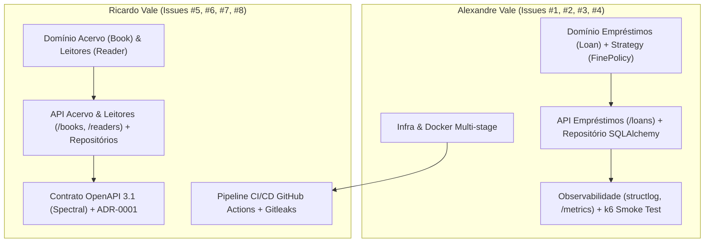

# Matriz de Responsabilidades e Contribuidores (Pair Programming)

> **Projeto:** FullCycle 4.0 — API de Biblioteca (Projeto B)  
> **Formato de Trabalho:** Trabalho em Dupla com Divisão Vertical de Módulos (Clean Architecture)

---

## 👥 Membros da Equipe

| Nome do Membro | Papel Principal | GitHub / Usuário |
| :--- | :--- | :--- |
| **Alexandre Vale** | Engenharia de Backend, Infraestrutura Docker & Observabilidade | [@alexandresvale](https://github.com/alexandresvale) |
| **Ricardo Vale** | Engenharia de Backend, Pipeline CI/CD & Contratos de API | [@ricardosvale](https://github.com/ricardosvale)|

---

## 🧩 Divisão Vertical de Módulos e Entregas

Para assegurar independência técnica, produtividade contínua e evitar conflitos em Pull Requests, o projeto foi particionado em fatias verticais (*vertical slicing*) de ponta a ponta:

---

## 📋 Detalhamento das Fatias Técnicas

### 1. Alexandre Vale
- **Infraestrutura e Contêineres (M1 / M3):**
  - Setup do projeto Python 3.13 com Poetry/pyproject.toml.
  - Criação do `Dockerfile` multi-stage com usuário seguro não-root (`appuser`).
  - Configuração do `docker-compose.yaml` com serviços `db` (Postgres 16 Alpine com healthcheck `pg_isready`), `api` (com healthcheck interno) e `k6` (perfil de teste de carga).
- **Módulo de Empréstimos — `src/modules/loans/` (M1 / M2):**
  - Entidade rica `Loan` com proteção de regras de negócio (devolução, datas, multas).
  - Implementação do Strategy Pattern (`FinePolicy`, `StandardFinePolicy`, `AcademicFinePolicy`) via `typing.Protocol`.
  - Casos de uso de aplicação: `BorrowBookUseCase` e `ReturnBookUseCase`.
  - Camada de dados com `LoanModel` (SQLAlchemy 2.0) e `SqlAlchemyLoanRepository`.
  - Endpoints RESTful em `src/modules/loans/api/` (`POST /loans`, `GET /loans`, `POST /loans/{id}/return`).
- **Observabilidade, Performance e SLOs (M3 / M4):**
  - Middleware de observabilidade injetando `X-Request-ID` e calculando duração de requisições.
  - Logs estruturados em JSON com `structlog`.
  - Coleta e exposição de métricas Prometheus (`/metrics`) com prevenção de explosão de cardinalidade.
  - Automação de teste de fumaça k6 (`tests/perf/smoke.js`) e relatório `docs/desempenho.md`.

### 2. Ricardo Vale
- **Pipeline de Integração Contínua (M2 / M3):**
  - Esteira automatizada no GitHub Actions (`.github/workflows/ci.yml`) disparada em `push` e `pull_request` nas branches `develop` e `main`.
  - Etapas de segurança com `gitleaks` para prevenção de credenciais e segredos commitados.
  - Verificação estática com `ruff check`, `ruff format --check` e `mypy src`.
  - Execução de testes automatizados com container de serviço PostgreSQL e cobertura mínima de 80%.
- **Módulos de Acervo e Leitores — `src/modules/books/` e `src/modules/readers/` (M1 / M2):**
  - Entidades de domínio `Book` (com invariantes de `total_copies` e `available_copies`) e `Reader`.
  - Protocolos de repositório e casos de uso de cadastro, consulta e controle de estoque de livros.
  - Mapeamento ORM e repositórios concretos no PostgreSQL.
  - Endpoints RESTful para `/books` e `/readers`.
- **Contratos e Arquitetura Formal (M4):**
  - Especificação OpenAPI 3.1 em `docs/openapi.yaml` cobrindo todos os endpoints da biblioteca.
  - Validação automatizada do contrato com `Spectral` (`.spectral.yaml`).
  - Redação do Registro de Decisão Arquitetural (`docs/adr/0001-strategy-multa-e-arquitetura.md`) no formato MADR com alternativa descartada explícita.
