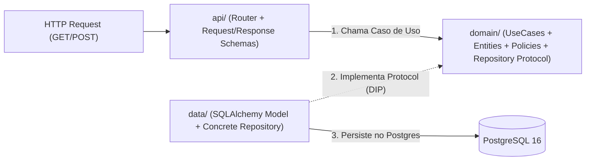

# Documento de Requisitos e Arquitetura Modular — API de Biblioteca (Projeto B)

> **Projeto:** FullCycle 4.0 — API RESTful de Gestão de Biblioteca (Acervo, Leitores, Empréstimos e Devoluções)  
> **Stack Tecnológica:** Python 3.13 · FastAPI · SQLAlchemy 2.0 · Alembic · PostgreSQL 16 · Pytest · Structlog · Prometheus · k6  
> **Padrão Arquitetural:** Clean Architecture Modular (*Package by Feature / Vertical Slices*)

---

## 1. Visão Geral e Objetivo Arquitetural

Este documento estabelece a fonte única da verdade (*Single Source of Truth*) para os requisitos funcionais, regras de negócio, contratos de API e limites arquiteturais do sistema de Biblioteca. Seu objetivo é dupla finalidade:
1. Guiar o desenvolvimento paralelo em dupla (**Fatia 1: Acervo & Leitores** | **Fatia 2: Empréstimos, Devoluções & Observabilidade**) sem conflitos de merge.
2. Servir de contexto determinístico para assistentes de IA, impedindo desvios arquiteturais, modelos anêmicos ou acoplamento indevido entre camadas.

### Decisões de Design
- **O Porquê:** Dividir cada feature em `api/` (porta de entrada HTTP), `domain/` (entidades, policies, protocolos e casos de uso puros) e `data/` (persistência SQLAlchemy) usa nomenclatura que revela exatamente a intenção de cada camada.
- **Alternativas:** Usar `infra/` dentro da feature foi descartado por ser genérico demais para uma pasta que cuida apenas de acesso a dados; colocar rotas em `infra/http` foi descartado por misturar entrada e saída.
- **Trade-offs:** Mantém 3 subpastas curtas e autoexplicativas por feature (`api`, `domain`, `data`), facilitando os imports (`src.modules.loans.data...`) e zerando conflitos de Git na dupla.

---

## 2. Estrutura de Diretórios (Clean Architecture por Funcionalidade)

```text
fullcycle-biblioteca-api/
├─ .agents/
│  └─ skills/
│     └─ senior-python-clean-arch/
│        └─ SKILL.md                        # Skill de Engenharia Backend Python Sênior
├─ alembic/                                 # Migrations versionadas do PostgreSQL
├─ docs/
│  ├─ adr/
│  │  └─ 0001-strategy-multa-e-arquitetura.md
│  ├─ openapi.yaml                          # Contrato OpenAPI 3.1 (validado via Spectral)
│  ├─ requisitos-sistema.md                 # Este documento de requisitos
│  ├─ desempenho.md                         # Relatório do smoke test k6 vs. SLO
│  └─ ia.md                                 # Registro de uso de IA e engenharia de prompts
├─ src/
│  ├─ main.py                               # Composition Root único (FastAPI app, routers, middlewares)
│  ├─ core/                                 # Kernel Compartilhado / Cross-Cutting Concerns
│  │  ├─ config.py                          # Pydantic Settings (.env)
│  │  ├─ database.py                        # SQLAlchemy 2.0 Engine, SessionLocal, Base, get_db
│  │  ├─ exceptions.py                      # Hierarquia base: DomainError, NotFoundError, ConflictError
│  │  └─ observability/                     # Middleware Structlog JSON + Prometheus (/metrics, /health)
│  └─ modules/                              # Módulos de Negócio (Features Isoladas)
│     ├─ books/                             # [Módulo 1: Acervo] (Responsável: Ricardo Vale)
│     │  ├─ api/                            # Porta de Entrada HTTP (router.py, schemas.py, dependencies.py)
│     │  ├─ domain/                         # Núcleo Puro (entities.py, repositories.py, usecases/, exceptions.py)
│     │  └─ data/                           # Camada de Dados / DB (model.py, repository_sqlalchemy.py)
│     ├─ readers/                           # [Módulo 2: Leitores] (Responsável: Ricardo Vale)
│     │  ├─ api/                            # Porta de Entrada HTTP (router.py, schemas.py, dependencies.py)
│     │  ├─ domain/                         # Núcleo Puro (entities.py, repositories.py, usecases/, exceptions.py)
│     │  └─ data/                           # Camada de Dados / DB (model.py, repository_sqlalchemy.py)
│     └─ loans/                             # [Módulo 3: Empréstimos e Devoluções] (Responsável: Alexandre Vale)
│        ├─ api/                            # Porta de Entrada HTTP (loans_router.py, loan_schema.py, dependencies.py)
│        ├─ domain/                         # Núcleo Puro (loan.py, fine_policy.py, loan_repository.py, usecases/)
│        └─ data/                           # Camada de Dados / DB (loan_model.py, loan_repository_sqlalchemy.py)
└─ tests/
   ├─ unit/                                 # Testes rápidos em memória (sem I/O, sem banco, sem FastAPI)
   │  ├─ books/
   │  ├─ readers/
   │  └─ loans/
   ├─ integration/                          # Testes de ponta a ponta (FastAPI TestClient + PostgreSQL real)
   │  ├─ test_books_api.py
   │  ├─ test_readers_api.py
   │  └─ test_loans_api.py
   └─ perf/
      └─ smoke.js                           # Teste de carga k6
```

### Regra da Dependência e Fluxo da Requisição (Inviolável)



> [!IMPORTANT]
> **`domain/` NUNCA importa nada de `api/`, `data/`, `fastapi`, `sqlalchemy` ou `pydantic`.**
> - **`api/`** é a porta de entrada (Driving Adapter): recebe a Request HTTP, valida o payload com Pydantic (`schemas.py`), aciona o Caso de Uso em `domain/usecases/` e devolve o Response Schema.
> - **`data/`** é a porta de saída de persistência (Driven Adapter): implementa o contrato `Protocol` definido em `domain/` conversando com o PostgreSQL via SQLAlchemy.

---

## 3. Requisitos Funcionais e Regras de Negócio por Módulo

### 3.1. Módulo `books` (Gestão de Acervo)

#### Entidade de Domínio: `Book`
- **Atributos:**

| Atributo | Tipo | Obrigatório / Padrão | Descrição no Domínio |
| :--- | :--- | :--- | :--- |
| `id` | `UUID` | Padrão (`uuid4`) | Identificador único universal do livro no acervo. |
| `title` | `str` | Obrigatório | Título da obra literária ou acadêmica (não vazio, máx. 200 caracteres). |
| `author` | `str` | Obrigatório | Nome do autor ou autores principais da obra (não vazio, máx. 150 caracteres). |
| `isbn` | `str` | Obrigatório (Único) | Código internacional padronizado do livro (ISBN-10 ou ISBN-13 normalizado). |
| `total_copies` | `int` | Obrigatório (`>= 1`) | Quantidade total de exemplares físicos pertencentes à biblioteca. |
| `available_copies` | `int` | Inicializado `= total_copies` | Saldo atual de exemplares disponíveis na estante para empréstimo (`0 <= available_copies <= total_copies`). |

- **Comportamentos Ricos (POO no Domínio):**
  - `has_available_copy() -> bool`: retorna `self.available_copies > 0`.
  - `allocate_copy() -> None`: decrementa `available_copies` em 1; lança `BookUnavailableError` se `available_copies == 0`.
  - `release_copy() -> None`: incrementa `available_copies` em 1; lança `DomainError` se tentar ultrapassar `total_copies`.

#### Regras de Negócio (Acervo)
- **RN-B01 (ISBN Único):** Não é permitido cadastrar dois livros com o mesmo ISBN (`409 Conflict`).
- **RN-B02 (Integridade de Exemplares):** Ao criar um livro com `total_copies = N`, `available_copies` inicia obrigatoriamente igual a `N` (com `N >= 1`).

#### Endpoints REST (`/books`)
| Método | Rota | Status Sucesso | Status de Erro | Descrição |
| :--- | :--- | :--- | :--- | :--- |
| `POST` | `/books` | `201 Created` | `400`, `409` (ISBN duplicado), `422` | Cadastra novo livro no acervo. |
| `GET` | `/books` | `200 OK` | — | Lista livros do acervo (suporta filtro opcional `?available_only=true`). |
| `GET` | `/books/{book_id}` | `200 OK` | `404 Not Found` | Consulta detalhes e saldo de exemplares de um livro. |

---

### 3.2. Módulo `readers` (Gestão de Leitores)

#### Entidade de Domínio: `Reader`
- **Atributos:**

| Atributo | Tipo | Obrigatório / Padrão | Descrição no Domínio |
| :--- | :--- | :--- | :--- |
| `id` | `UUID` | Padrão (`uuid4`) | Identificador único universal do leitor cadastrado. |
| `name` | `str` | Obrigatório | Nome completo do leitor (mínimo de 3 caracteres). |
| `email` | `str` | Obrigatório (Único) | Endereço de e-mail do leitor para contato e notificações. |
| `document` | `str` | Obrigatório (Único) | Documento de identificação oficial (CPF ou matrícula institucional normalizada). |
| `category` | `ReaderCategory` | Padrão (`STANDARD`) | Perfil do leitor (`STANDARD` para público geral ou `ACADEMIC` para docentes/pesquisadores com carência de multa). |
| `active` | `bool` | Padrão (`True`) | Indica se o cadastro do leitor está ativo e apto a realizar novos empréstimos. |

- **Regras de Negócio (Leitores):**
  - **RN-R01 (Unicidade de Identificação):** `email` e `document` devem ser únicos no sistema (`409 Conflict` em caso de duplicidade).
  - **RN-R02 (Categoria de Leitor):** A categoria (`STANDARD` vs. `ACADEMIC`) determina automaticamente qual política de multa (`FinePolicy`) pode ser aplicada na devolução ou serve de padrão para o leitor.
  - **RN-R03 (Status do Leitor):** Leitores com `active = False` não podem realizar novos empréstimos.

#### Endpoints REST (`/readers`)
| Método | Rota | Status Sucesso | Status de Erro | Descrição |
| :--- | :--- | :--- | :--- | :--- |
| `POST` | `/readers` | `201 Created` | `400`, `409` (E-mail/Doc duplicado), `422` | Cadastra um novo leitor. |
| `GET` | `/readers` | `200 OK` | — | Lista leitores cadastrados. |
| `GET` | `/readers/{reader_id}` | `200 OK` | `404 Not Found` | Busca dados de um leitor específico. |

---

### 3.3. Módulo `loans` (Gestão de Empréstimos e Devoluções)

#### Entidade de Domínio: `Loan`
- **Atributos:**

| Atributo | Tipo | Obrigatório / Padrão | Descrição no Domínio |
| :--- | :--- | :--- | :--- |
| `id` | `UUID` | Padrão (`uuid4`) | Identificador único universal do registro de empréstimo. |
| `book_id` | `UUID` | Obrigatório | Identificador do livro/exemplar que está sendo emprestado. |
| `reader_id` | `UUID` | Obrigatório | Identificador do leitor responsável pelo empréstimo. |
| `borrowed_at` | `date` | Obrigatório | Data efetiva em que o empréstimo foi realizado. |
| `due_date` | `date` | Obrigatório | Data limite prevista para devolução sem incidência de atraso (`due_date >= borrowed_at`). |
| `returned_at` | `date \| None` | Padrão (`None`) | Data efetiva em que o exemplar foi devolvido (`None` enquanto o empréstimo estiver em aberto). |
| `fine_amount` | `Decimal` | Padrão (`Decimal("0.00")`) | Valor monetário da multa calculada no ato da devolução via `FinePolicy` (duas casas decimais). |
| `status` | `LoanStatus` | Padrão (`ACTIVE`) | Estado atual do ciclo de vida do empréstimo (`ACTIVE` enquanto emprestado; `RETURNED` após devolução). |
- **Comportamentos Ricos (POO no Domínio):**
  - `__post_init__()`: garante que `due_date >= borrowed_at`, lançando `DomainError` caso contrário.
  - `days_overdue(reference_date: date) -> int`: calcula dias corridos após `due_date` (`0` se devolvido no prazo).
  - `return_book(returned_at: date, fine_policy: FinePolicy) -> Decimal`:
    - Impede devolução duplicada se `status == LoanStatus.RETURNED` (`LoanAlreadyReturnedError`).
    - Impede `returned_at < borrowed_at` (`DomainError`).
    - Calcula `fine_amount` delegando para a estratégia `fine_policy.calculate_fine(overdue_days)`.
    - Altera `status` para `LoanStatus.RETURNED` e registra `returned_at`.

#### Regras de Negócio (Empréstimos e Devoluções)
- **RN-L01 (Disponibilidade de Exemplar):** Um empréstimo só pode ser criado se o livro existir e possuir exemplar disponível (no modo simplificado sem tabela `books` ainda integrada, verifica se o `book_id` não possui empréstimo `ACTIVE`; após integração com `BookRepository`, valida e decrementa `available_copies`).
- **RN-L02 (Limite de Empréstimos Simultâneos):** Cada leitor pode ter no máximo **3 empréstimos com status `ACTIVE`** simultaneamente. Na 4ª tentativa, lançar `LoanLimitExceededError` (`422 Unprocessable Entity`).
- **RN-L03 (Datas Coerentes):** `due_date` não pode ser anterior a `borrowed_at`, e `returned_at` não pode ser anterior a `borrowed_at` (`400 Bad Request`).
- **RN-L04 (Imutabilidade de Empréstimo Finalizado):** Um empréstimo já devolvido (`RETURNED`) não pode ser devolvido novamente (`409 Conflict`).
- **RN-L05 (Cálculo de Multa via Strategy Pattern — OCP):**
  - **`StandardDailyFinePolicy`:** Cobra `R$ 2,00` por dia de atraso (`days_overdue * 2.00`), sem carência.
  - **`AcademicGraceFinePolicy`:** Concede `2 dias` de carência (`grace_days = 2`). Se o atraso for `<= 2` dias, a multa é `R$ 0,00`. Acima de 2 dias, cobra `R$ 1,50` por dia excedente à carência (`(days_overdue - 2) * 1.50`).

#### Endpoints REST (`/loans`)
| Método | Rota | Status Sucesso | Status de Erro | Descrição |
| :--- | :--- | :--- | :--- | :--- |
| `POST` | `/loans` | `201 Created` | `400` (Datas inválidas), `404` (Livro/Leitor inexistente), `409` (Livro indisponível), `422` (Limite de 3 ativos excedido) | Registra um novo empréstimo. |
| `POST` | `/loans/{loan_id}/return` | `200 OK` | `400` (Data inválida), `404` (Empréstimo não existe), `409` (Já devolvido) | Registra a devolução e calcula multa. |
| `GET` | `/loans` | `200 OK` | — | Lista empréstimos (ordenados do mais recente ao mais antigo). |
| `GET` | `/loans/{loan_id}` | `200 OK` | `404 Not Found` | Detalha um empréstimo específico. |

---

## 4. Integração Desacoplada entre Módulos (Como Evitar Acoplamento)

Para que o módulo `loans` (Alexandre Vale) não fique bloqueado esperando o módulo `books` e `readers` (Ricardo Vale), e para que não haja acoplamento entre os modelos ORM (`LoanModel` importando `BookModel`), a comunicação segue o **Princípio da Inversão de Dependência (DIP)**:

1. **Fase 1 (Desenvolvimento Paralelo Independente):**
   - `BorrowBookUseCase` depende apenas de `LoanRepository` (Protocolo do próprio módulo `loans`), validando disponibilidade via `has_active_loan_for_book(book_id)` e limite via `count_active_by_reader(reader_id)`.
2. **Fase 2 (Integração Opcional via Porta de Domínio):**
   - Se desejarem validar saldo de múltiplos exemplares (`available_copies`), `loans/domain/` define um protocolo mínimo `CatalogCheckerProtocol` (ou recebe `BookRepository` injetado como opcional), mantendo **100% dos testes unitários de `loans` funcionando com Fakes in-memory** em menos de 50ms.

---

## 5. Requisitos Não-Funcionais, Observabilidade e Qualidade (M2, M3 e M4)

| ID | Categoria | Requisito Obrigatório (Rubrica Projeto B) |
| :--- | :--- | :--- |
| **RNF-01** | **Testes e Cobertura** | Cobertura automatizada `>= 80%` em `src/` validada via `pytest --cov=src --cov-fail-under=80` (Testes Unitários com Fakes in-memory + Testes de Integração com PostgreSQL 16 real). |
| **RNF-02** | **Qualidade Estática** | Zero erros ou avisos no `ruff check src tests`, `ruff format --check src tests` e tipagem estrita validada com `mypy src`. |
| **RNF-03** | **Segurança & Segredos** | Container executando com usuário não-root (`appuser`), `.env` fora do controle de versão e verificação automática via `gitleaks` no GitHub Actions. |
| **RNF-04** | **Logs Estruturados** | Logs em formato **JSON** (`structlog`) contendo obrigatoriamente `timestamp`, `level`, `request_id` (UUID), `method`, `path`, `status_code` e `duration_ms`. |
| **RNF-05** | **Métricas e Health** | Endpoint `GET /health` validando conectividade com o banco (`SELECT 1`) e `GET /metrics` expondo métricas Prometheus (`http_requests_total` e `http_request_duration_seconds`). |
| **RNF-06** | **SLO e Performance** | Smoke test no `k6` (`tests/perf/smoke.js`) comprovando **Taxa de Erro < 1%** (`http_req_failed < 0.01`) e **Latência `p95 <= 200ms`** (`http_req_duration: p(95)<200`). |
| **RNF-07** | **Contrato OpenAPI** | Especificação `docs/openapi.yaml` (OpenAPI 3.1) sincronizada com as rotas e aprovada sem erros pelo linter `@stoplight/spectral-cli`. |

---

## 6. Mapeamento Padronizado de Exceções de Domínio para HTTP

Todas as rotas FastAPI (ou um Exception Handler global registrado em `src/main.py`) devem traduzir exceções de domínio de forma determinística:

| Exceção de Domínio | HTTP Status Code | Significado Semântico |
| :--- | :--- | :--- |
| `NotFoundError` (`LoanNotFoundError`, `BookNotFoundError`, `ReaderNotFoundError`) | `404 Not Found` | Recurso solicitado não existe no banco de dados. |
| `ConflictError` (`BookUnavailableError`, `LoanAlreadyReturnedError`, `DuplicateIsbnError`, `DuplicateReaderError`) | `409 Conflict` | Conflito com o estado atual do recurso (já emprestado, já devolvido, registro duplicado). |
| `LoanLimitExceededError` / `InactiveReaderError` | `422 Unprocessable Entity` | Entidade válida sintaticamente, mas reprovada por política de limite/elegibilidade. |
| `DomainError` (ex.: datas inválidas `due_date < borrowed_at`) | `400 Bad Request` | Violação de invariante básica de negócio. |
